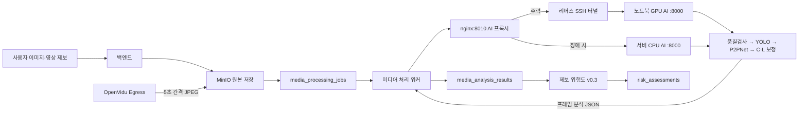

# SAFY 운영 AI 분석 최종 명세

## 1. 문서 상태

- 기준일: `2026-08-05`
- 상태: 현재 운영 코드와 배포 구성을 설명하는 최종 기준
- 적용 범위: 이미지·영상 프레임 분석, C·L 보정, 제보 위험도, 블러, GPU 주력·CPU 폴백
- 모델:
  - YOLO: `YOLO / yolo11n / yolo11n.pt`
  - P2PNet: `P2PNet / safy-p2pnet-v2-epoch3 / epoch-003.pth`
- 규칙 버전:
  - 프레임 품질: `frame-quality-v0.3`
  - C·L 계산: `yolo-grid-v0.2`
  - 제보 위험도: `safy-risk-v0.3`
  - 전체 이미지 블러: `full-image-blur-v0.1`

이 문서는 SAFY가 운영 환경에서 이미지를 어떤 경로로 받고, YOLO와 P2PNet을
어떻게 사용하며, 어떤 값을 백엔드에 반환하고, 백엔드가 제보 단위 위험도를
어떻게 만드는지 한 곳에 정리한다.

과거 그림자 분석, 후보 모델 비교 및 보정 제안 문서와 내용이 충돌하면 현재
운영 상태에 대해서는 이 문서를 우선한다. 과거 문서는 결정 근거와 실험 기록으로
사용한다.

## 2. 현재 운영 결정

| 항목 | 현재 결정 |
|---|---|
| 정상 프레임 | YOLO와 P2PNet을 모두 실행 |
| 실행 방식 | 한 요청 안에서 YOLO를 먼저 실행하고 P2PNet을 이어서 실행 |
| 공식 사람 수 | YOLO `personCount` 유지 |
| P2PNet 역할 | 고밀도 장면에서 YOLO가 놓친 C·L을 상향 보정 |
| 오탐 방어 | 0.5~0.6 confidence 점 비율 기반 오탐 게이트 |
| 게이트 발동 | YOLO C·L 유지 |
| 게이트 미발동 | C와 L 각각 YOLO·P2PNet 중 큰 값 사용 |
| 최종 위험도 | AI가 아닌 백엔드가 C·L·P·G로 계산 |
| GPU 운영 | RTX 4050 노트북을 주력 AI 서버로 사용 |
| GPU 장애 | 배포 서버 CPU AI 컨테이너로 자동 폴백 |
| 실패 프레임 | 사람 0명으로 바꾸지 않고 제보 위험도에서 제외 |
| 개인정보 | 전체 블러 처리된 대표 이미지 제공 |

“두 모델을 함께 사용한다”는 것은 같은 정상 프레임에 두 모델을 모두 실행한다는
뜻이다. 현재 구현은 GPU에서 병렬 실행하지 않고 `YOLO → P2PNet` 순서로 실행한다.

## 3. 전체 처리 구조



### 이미지 제보

1. 백엔드가 원본 이미지를 MinIO에 저장한다.
2. `ANALYZE_AND_BLUR` 작업을 생성한다.
3. 워커가 AI 단일 프레임 분석 API를 호출한다.
4. 결과를 저장하고 제보 위험도를 갱신한다.

### 영상 제보

1. OpenVidu Egress가 영상에서 5초 간격으로 JPEG 프레임을 추출한다.
2. 백엔드가 새 프레임을 `extracted_frames`와 `media_assets`에 등록한다.
3. 프레임마다 `ANALYZE_AND_BLUR` 작업을 생성한다.
4. 정상 완료된 프레임만 제보 단위 C·L·P·G 계산에 사용한다.

AI는 영상을 직접 구독하거나 프레임을 추출하지 않고 전달받은 이미지 한 장만
분석한다.

### 백엔드 작업 큐

- 워커 폴링 간격: `2초`
- 한 번의 폴링에서 최대 `10건` 처리
- 현재 워커는 작업을 순차 처리
- 1분 이상 `PROCESSING`인 작업은 중단된 작업으로 보고 다시 대기 상태로 전환
- AI `FAILED` 응답과 통신 실패는 1회 재시도하여 총 2회 요청
- `INVALID_FRAME`은 재시도하지 않음

## 4. AI API 계약

### 요청

```http
POST /api/v1/analyze/frame
Content-Type: multipart/form-data
```

| 필드 | 형식 | 설명 |
|---|---|---|
| `image` | 이미지 파일 | 분석할 단일 이미지 또는 추출 프레임 |

- 이미지가 아닌 Content-Type: HTTP `415`
- 빈 파일: HTTP `400`
- 사용자 이미지 제보 제한: 이미지 한 장당 `10MB`, 최대 5장
- AI 운영 프록시의 내부 요청 제한: `20MB`

사용자 업로드의 10MB 제한이 먼저 적용된다. 프록시의 20MB는 백엔드가 AI에
전달하는 단일 프레임 요청을 위한 내부 상한이며 사용자 업로드 허용량이 아니다.

### `COMPLETED` 응답 예시

```json
{
  "analysisStatus": "COMPLETED",
  "personCount": 23,
  "personConfidences": [0.87, 0.81, 0.80],
  "visualCongestionScore": 10.78,
  "localPeakCongestionScore": 52.5,
  "congestionSource": "P2PNET_CORRECTED",
  "densityLevel": null,
  "riskScore": null,
  "confidence": null,
  "qualityIssues": [],
  "failureCodes": [],
  "frameWidth": 1024,
  "frameHeight": 768,
  "brightnessScore": 126.59,
  "blurScore": 492.62,
  "modelName": "YOLO",
  "modelVersion": "yolo11n",
  "modelWeightId": "yolo11n.pt",
  "congestionRuleVersion": "yolo-grid-v0.2",
  "frameQualityRuleVersion": "frame-quality-v0.3",
  "processingTimeMs": 92
}
```

### 필드 의미와 저장

| AI JSON 필드 | 의미 | 백엔드 처리 |
|---|---|---|
| `analysisStatus` | 프레임 분석 상태 | 저장 |
| `personCount` | YOLO 사람 수 | 저장 |
| `personConfidences` | YOLO 개별 탐지 confidence | 응답에는 포함하지만 DB에는 저장하지 않음 |
| `visualCongestionScore` | 보정 후 C | 저장, 제보 위험도 입력 |
| `localPeakCongestionScore` | 보정 후 L | 저장, 제보 위험도 입력 |
| `congestionSource` | `YOLO` 또는 `P2PNET_CORRECTED` | 저장 |
| `densityLevel`, `riskScore` | AI 계산 범위 아님 | `null` |
| `confidence` | 전체 분석 신뢰도 | 현재 보정 근거가 없어 `null` |
| `qualityIssues`, `failureCodes` | 품질·실패 코드 배열 | 저장 |
| 크기·밝기·블러 | 프레임 품질 측정값 | 저장 |
| 모델·규칙 버전 | 재현 및 추적 메타데이터 | 저장 |
| `processingTimeMs` | YOLO 탐지 처리시간 | 저장 |

`modelName`, `modelVersion`, `modelWeightId`는 공식 `personCount`를 생성하는 YOLO
메타데이터다. P2PNet 정보와 처리시간은 내부 응답 헤더와 구조화 로그로 관측한다.

백엔드 제보 분석 조회 API는 현재 프레임별 `personCount` 최댓값을
`crowdCount`라는 필드명으로 반환한다. 이 값은 C·L이 아니라 YOLO 사람 수다.

## 5. 프레임 품질 검사

사람 탐지 전에 `frame-quality-v0.3`으로 검사한다.

| 항목 | 기준 | 실패 코드 |
|---|---:|---|
| 짧은 변 | `240px` 이상 | `LOW_RESOLUTION` |
| 전체 픽셀 | `320 × 240` 이상 | `LOW_RESOLUTION` |
| 평균 밝기 | `35.0` 이상 | `TOO_DARK` |
| 평균 밝기 | `220.0` 이하 | `TOO_BRIGHT` |
| Laplacian 분산 | `80.0` 이상 | `TOO_BLURRY` |
| 디코딩 | 성공 | `DECODE_FAILED` |

고해상도 블러 측정은 짧은 변이 720px보다 크면 측정용 회색조 이미지만 짧은 변
720px로 축소한다. 원본 분석 이미지를 확대하지 않는다.

품질 실패 응답:

```text
analysisStatus = INVALID_FRAME
personCount = null
C = null
L = null
qualityIssues = [실패 코드...]
failureCodes = []
```

`INVALID_FRAME`은 사람이 0명인 프레임이 아니며 제보 위험도 계산에서 제외한다.

## 6. YOLO 분석

- 모델: YOLO11n
- 클래스: COCO `person` 클래스 `0`
- 장치: CUDA 사용 가능 시 GPU `0`, 아니면 CPU
- 출력: 사람 수, confidence, 정규화 바운딩 박스와 중심점

YOLO의 `personCount`는 공식 사람 수로 유지한다. 고밀도에서 가려진 사람과 작은
사람을 놓칠 수 있으므로 C·L에 대해서는 P2PNet 보정을 허용한다.

YOLO 탐지 또는 중심점 C·L 계산이 실패하면 P2PNet만으로 완료 처리하지 않는다.
각각 `MODEL_INFERENCE_FAILED`, `CONGESTION_CALCULATION_FAILED`로 `FAILED`를
반환한다.

## 7. P2PNet 분석

- 구조: VGG16-BN 기반 P2PNet
- 버전: `safy-p2pnet-v2-epoch3`
- 가중치 ID: `p2pnet-finetune-v2-balanced-search/epoch-003.pth`
- SHA-256: `934989b1ec644660f3924fb916418cb7f757b11f35b470af46c324ac18204857`
- 외부 소스 고정 커밋: `5c91a81ca062b1c7fd3db3ad1c55b1c21f0a7455`
- 점 confidence 임계값: `0.5`
- 입력 긴 변 최대: `1536px`
- 입력 크기 정렬 단위: `128px`
- EXIF 방향 보정 후 RGB 입력

P2PNet은 사람 머리 위치를 점으로 예측한다. confidence가 `0.5` 이상인 점을
채택하고 원본 이미지 기준 정규화 좌표로 환산한 뒤 YOLO와 같은 C·L 계산기에
넣는다.

정확도 우선 운영에서는 P2PNet이 비활성·실패·시간 초과이면 YOLO만으로
`COMPLETED`를 반환하지 않고 해당 프레임을 `FAILED`로 반환한다. 백엔드가 한 번
재시도한 뒤에도 실패하면 제보 위험도 계산에서 제외한다.

## 8. C·L 계산 `yolo-grid-v0.2`

두 모델 좌표를 각각 8×8 이미지 격자로 계산한다.

### 칸별 점수

```text
cellScore = min(cellPersonCount × 30, 100)
```

### C: 전체 시각적 혼잡도

```text
C = 64개 cellScore의 평균
```

### L: 국소 최대 혼잡도

인접한 2×2 칸 49개를 검사한다.

```text
windowPersonCount = 2×2 네 칸의 총 사람 수
windowScore = min(windowPersonCount × 30 / 4, 100)
L = 49개 windowScore 중 최댓값
```

v0.2는 칸 점수를 먼저 자른 뒤 평균내지 않고 2×2 인원을 먼저 합산해 영역
점수를 계산한다.

## 9. P2PNet 오탐 게이트

P2PNet이 나뭇잎, 좌석, 반복 무늬를 머리로 대량 오인하는 문제를 줄이기 위해
채택한 점의 confidence 분포를 검사한다.

```text
채택 점 = confidence >= 0.5
경계 점 = 0.5 <= confidence < 0.6
경계 점 비율 = 경계 점 수 / 전체 채택 점 수

경계 점 비율 >= 0.15
    → lowConfidenceSignal = true
    → 오탐 게이트 발동
```

점이 없으면 게이트는 발동하지 않는다. `15%`는 JHU 홀드아웃의 대형 오탐
23건과 정상 21건으로 보정했으며 당시 정확도 81.8%, 재현율·정밀도 82.6%였다.
표본이 작으므로 운영 정답 라벨이 쌓이면 재검증해야 한다.

## 10. YOLO·P2PNet C·L 보정

C와 L을 독립적으로 판단한다.

```text
if P2PNet status != COMPLETED:
    정확도 우선 모드에서는 프레임 FAILED

elif falsePositiveGateTriggered:
    finalC = yoloC
    finalL = yoloL
    congestionSource = YOLO

else:
    finalC = max(yoloC, p2pnetC)
    finalL = max(yoloL, p2pnetL)

    if C 또는 L이 YOLO보다 증가:
        congestionSource = P2PNET_CORRECTED
    else:
        congestionSource = YOLO
```

P2PNet은 C·L을 낮추는 방향으로 사용하지 않는다. YOLO C가 더 크고 P2PNet L이
더 크면 최종 C는 YOLO, 최종 L은 P2PNet 값이다. `personCount`는 보정과 무관하게
항상 YOLO 값이다.

## 11. 프레임 상태와 실패 처리

| 상태 | 의미 | 사람 수·C·L | 재시도 | 제보 위험도 |
|---|---|---|---:|---:|
| `COMPLETED` | 품질 및 두 모델 완료 | 값 존재 | 없음 | 사용 |
| `INVALID_FRAME` | 품질 실패 | `null` | 없음 | 제외 |
| `FAILED` | 모델·계산·내부 오류 | `null` | 1회 | 최종 실패 시 제외 |

AI 내부 실패 코드:

```text
MODEL_INFERENCE_FAILED
CONGESTION_CALCULATION_FAILED
INTERNAL_AI_ERROR
```

백엔드 통신·검증 실패 코드:

```text
AI_CONNECTION_FAILED
AI_TIMEOUT
INVALID_AI_RESPONSE
UNSUPPORTED_MEDIA_TYPE
EMPTY_IMAGE
```

실패 프레임은 사람 0명으로 저장하지 않는다. 실제 사람이 없는 정상 프레임만
`COMPLETED`, `personCount=0`, `C=0`, `L=0`이다.

## 12. 백엔드 저장과 제보 집계

프레임 결과는 `media_analysis_results`에 저장한다.

```text
analysis_status
person_count
visual_congestion_score
local_peak_congestion_score
congestion_source
quality_issues / failure_codes
frame_width / frame_height
brightness_score / blur_score
model_name / model_version / model_weight_id
congestion_rule_version / frame_quality_rule_version
processing_time_ms
observed_at / analyzed_at
```

제보 결과는 `risk_assessments`에 저장한다. `COMPLETED`이면서 C와 L이 있는
프레임만 사용한다.

한 제보에 `YOLO`와 `P2PNET_CORRECTED`가 섞이면
`congestionSourceMixed=true`로 기록하고 서로 다른 출처의 시계열을 직접 비교하지
않도록 P와 G는 `null`로 둔다.

## 13. 제보 위험도 `safy-risk-v0.3`

### 안정 C·L

프레임 C·L에 앞·현재·뒤 이동 중앙값을 적용하고 평활화된 값의 75백분위수(p75)를
사용한다.

```text
stableC = p75(movingMedian(frameC))
stableL = p75(movingMedian(frameL))
```

### 지속성 P

- 최소 6프레임
- 평활화된 `L >= 80`
- 정상 프레임 간 허용 간격 15초
- 60초 지속 시 100점

```text
P = min(혼잡 연속 시간 / 60초, 1) × 100
```

### 증가 추세 G

- 최소 6프레임
- 최근 30초 C 평균과 이전 30초 C 평균 비교
- 구간별 최소 2프레임

```text
ratio = (recentMeanC + 1) / (baselineMeanC + 1)
G = clamp((ratio - 1) × 100, 0, 100)
```

### 기본 위험점수

```text
rawRisk = 0.4 × stableC
        + 0.6 × stableL
        + 0.15 × P
        + 0.15 × G
```

P 또는 G가 `null`이면 해당 항은 더하지 않는다.

### 넓은 분산 장면 보정

```text
stableL >= 80
and stableC < 20
and (G가 null 또는 G < 30)
```

이 경우:

```text
finalRisk = min(rawRisk, 60)
confirmRequired = true
```

넓은 공원처럼 원근과 격자 때문에 L만 높은 장면을 자동 고위험으로 확정하지
않는다.

### 고위험 예외

```text
최소 HIGH:
    stableL >= 80
    and P >= 70
    and (stableC >= 20 or G >= 30)

최소 VERY_HIGH:
    stableL >= 90
    and P >= 70
    and stableC >= 20
    and G >= 30
```

### 위험단계

| 점수 | API 값 | 의미 |
|---:|---|---|
| `81.0 ~ 100.0` | `very_high` | 매우 높음 |
| `61.0 ~ 80.9` | `high` | 높음 |
| `41.0 ~ 60.9` | `medium` | 보통 |
| `21.0 ~ 40.9` | `low` | 낮음 |
| `0.0 ~ 20.9` | `very_low` | 매우 낮음 |

### 신뢰도와 관리자 확인

```text
sampleScore = min(completedFrameCount / 12, 1)
inclusionScore = completedFrameCount / totalFrameCount
qualityScore = qualityCleanFrameCount / completedFrameCount
riskConfidence = sampleScore × inclusionScore × qualityScore
```

다음 중 하나면 `confirmRequired=true`다.

- `riskConfidence < 0.5`
- P 또는 G 계산 불가
- 한 제보에 두 `congestionSource`가 섞임
- 넓은 분산 장면 보정 적용

단일 이미지는 P와 G가 없어 위험점수는 만들지만 관리자 확인이 필요하다.

## 14. 대표 이미지와 전체 블러

- API: `POST /api/v1/privacy/blur`
- 규칙: `full-image-blur-v0.1`
- 얼굴만 찾지 않고 이미지 전체 처리
- 원본의 10% 크기로 축소 후 복원해 픽셀화
- `sigma = max(3.0, 짧은 변 × 0.02)` 가우시안 블러
- JPEG 품질 `85`, 원본과 같은 해상도
- EXIF 메타데이터 미복사

현재 `ANALYZE_AND_BLUR` 작업은 각 처리 대상의 블러 파생본을 생성한다. 대표
이미지는 완료 프레임 중 L이 가장 높고, L이 같으면 C가 가장 높은 프레임의 블러
파생본이다. 블러 실패 시 원본을 대체 결과로 노출하지 않는다.

## 15. GPU 주력·CPU 자동 폴백

### 경로

```text
backend
  → nginx:8010
      → 주력 172.17.0.1:18001
          → host-network 중계
          → 서버 127.0.0.1:18000
          → reverse SSH tunnel
          → 노트북 GPU AI 127.0.0.1:8000

      → 예비 ai-server:8000
          → 배포 서버 CPU AI
```

백엔드는 `nginx:8010`만 호출한다. 주력 연결 실패·연결 타임아웃·HTTP
`502/503/504`이면 nginx가 같은 multipart 요청을 CPU AI로 재전송한다. 매 요청이
주력을 먼저 시도하므로 터널 복구 후 다음 요청부터 GPU로 자동 복귀한다.

AI가 HTTP 200과 `analysisStatus=FAILED`를 반환하면 프록시 폴백이 아니라 백엔드
1회 재시도가 처리한다.

### 타임아웃

```text
AI P2PNet: 30초
< nginx send/read: 35초
< backend read: 40초
```

| 구간 | 값 |
|---|---:|
| nginx 주력 connect | `2초` |
| nginx send/read | `35초` |
| backend connect | `5초` |
| backend read | `40초` |

### 운영 환경 변수

GPU 노트북:

```text
P2PNET_SHADOW_ENABLED=true
P2PNET_CONGESTION_CORRECTION_ENABLED=true
P2PNET_SHADOW_DEVICE=cuda
P2PNET_SHADOW_THRESHOLD=0.5
P2PNET_SHADOW_TIMEOUT_SECONDS=30
P2PNET_SHADOW_MODEL_VERSION=safy-p2pnet-v2-epoch3
P2PNET_SHADOW_WEIGHT_ID=p2pnet-finetune-v2-balanced-search/epoch-003.pth
```

CPU 폴백도 같은 이중 모델·보정 정책이며 장치만 `cpu`다. 저장소 compose 기본값은
안전을 위해 일부 스위치를 `false`, 타임아웃을 `5초`로 두지만 운영 `.env`가
두 스위치를 `true`, 타임아웃을 `30초`로 덮어쓴다.

비밀키, 인증 헤더와 자격증명은 이 문서와 Git에 기록하지 않는다.

## 16. GPU 노트북 운영

Windows 로그인 시 예약 작업이 자동 실행된다.

```text
SAFY AI Server
SAFY AI Tunnel
```

- AI Server: Uvicorn을 `127.0.0.1:8000`에서 실행하고 종료 시 재시작
- AI Tunnel: 리버스 SSH 터널을 연결하고 종료 시 재접속
- 전원 연결 시 절전·최대 절전 비활성화
- 운영 중 Windows 로그인과 네트워크 연결 유지

확인 명령:

```powershell
Get-ScheduledTask `
    -TaskName "SAFY AI Server","SAFY AI Tunnel" |
    Select-Object TaskName, State

curl.exe http://127.0.0.1:8000/health
ssh safy "curl -sS --max-time 10 http://127.0.0.1:18000/health"
ssh safy "docker exec infra-backend-1 wget -qO- http://nginx:8010/health"
```

정상 health에는 다음 값이 포함된다.

```json
{
  "status": "ok",
  "p2pnetShadow": {
    "ready": true,
    "status": "READY",
    "modelVersion": "safy-p2pnet-v2-epoch3"
  }
}
```

## 17. 모니터링

AI는 공개 JSON 대신 내부 응답 헤더로 두 모델 상태를 프록시에 전달한다.

| 헤더 | 의미 |
|---|---|
| `X-SAFY-AI-Mode` | `DUAL_MODEL` |
| `X-SAFY-P2PNet-Status` | 완료·실패·시간 초과 |
| `X-SAFY-Congestion-Source` | `YOLO` 또는 `P2PNET_CORRECTED` |
| `X-SAFY-P2PNet-Gate-Triggered` | 오탐 게이트 발동 여부 |
| `X-SAFY-YOLO-Processing-Time-Ms` | YOLO 시간 |
| `X-SAFY-P2PNet-Processing-Time-Ms` | P2PNet 시간 |
| `X-SAFY-Person-Count-Difference` | P2PNet 수 - YOLO 수 |
| `X-SAFY-Visual-Congestion-Difference` | P2PNet C - YOLO C |
| `X-SAFY-Local-Peak-Difference` | P2PNet L - YOLO L |

nginx는 이 값, `GPU_PRIMARY`·`CPU_FALLBACK`, 전체 요청시간을
`ai_dual_model_request` JSON 로그로 남긴다. Alloy → Loki → Grafana 경로에서
완료율, 보정률, 게이트 발동률, 모델별 시간과 전체 p95를 확인한다.

자동 폴백은 성공하면 전체 health가 계속 200이므로 GPU 주력
`172.17.0.1:18001/health`를 별도로 감시해야 노트북·터널 장애를 알 수 있다.

## 18. 운영 확인 체크리스트

### 배포 후

1. GPU 노트북과 터널 health가 `READY`인지 확인한다.
2. 백엔드 컨테이너에서 `nginx:8010/health`를 확인한다.
3. 정상 프레임 응답이 `COMPLETED`인지 확인한다.
4. `congestionSource`가 DB에 저장되는지 확인한다.
5. 로그의 `analysisMode=DUAL_MODEL`, `aiRoute`를 확인한다.
6. `risk_rule_version=safy-risk-v0.3`을 확인한다.

### 모델·점수 QA

1. 저밀도 장면에서 P2PNet 대형 오탐 게이트를 확인한다.
2. 고밀도에서 `P2PNET_CORRECTED` 적용을 확인한다.
3. 넓은 공원이 L만으로 자동 고위험이 되지 않는지 확인한다.
4. 실제 전체 군중과 증가 장면이 고위험을 유지하는지 확인한다.
5. 저해상도·어두움·블러 프레임이 `INVALID_FRAME`인지 확인한다.

## 19. 현재 한계

- `personCount`는 YOLO 값이라 고밀도에서 실제보다 작을 수 있다.
- P2PNet C·L은 상향만 허용하므로 게이트가 놓친 오탐은 점수를 올릴 수 있다.
- 오탐 게이트는 작은 홀드아웃으로 보정돼 운영 정답 라벨 기반 재검증이 필요하다.
- 8×8 격자는 촬영 거리, 원근과 실제 면적을 보정하지 않는다.
- GPU 노트북은 전원, 로그인과 네트워크에 의존한다.
- CPU 폴백은 유지 수단이지만 P2PNet 처리시간과 큐 대기가 증가한다.
- 단일 이미지는 P와 G를 계산할 수 없어 관리자 확인이 필요하다.
- 정확한 인원수를 시민에게 직접 제공하지 않고 위험 판단 보조 정보로 사용한다.

## 20. 관련 상세 문서

이 문서가 현재 운영의 최종 진입점이며, 아래 문서는 상세 근거와 과거 기록이다.

- [백엔드 연동 계약](backend-integration-contract.md)
- [C·L 계산 규칙](congestion-scoring.md)
- [프레임 품질 검증](frame-quality-validation.md)
- [영상 프레임 상태와 실패 처리](video-frame-analysis.md)
- [YOLO·P2PNet 비교](hybrid-model-comparison.md)
- [P2PNet C·L 보정 근거](official-congestion-correction-proposal.md)
- [이중 모델 운영 모니터링](dual-model-operational-monitoring.md)
- [제보 위험도 v0.3](risk-v03-calibration.md)
- [전체 이미지 블러](image-blur.md)
- [P2PNet 배포 자산](p2pnet-deployment-assets.md)
- [인프라 결정 기록](../../infra/docs/INFRA_DECISIONS.md)
